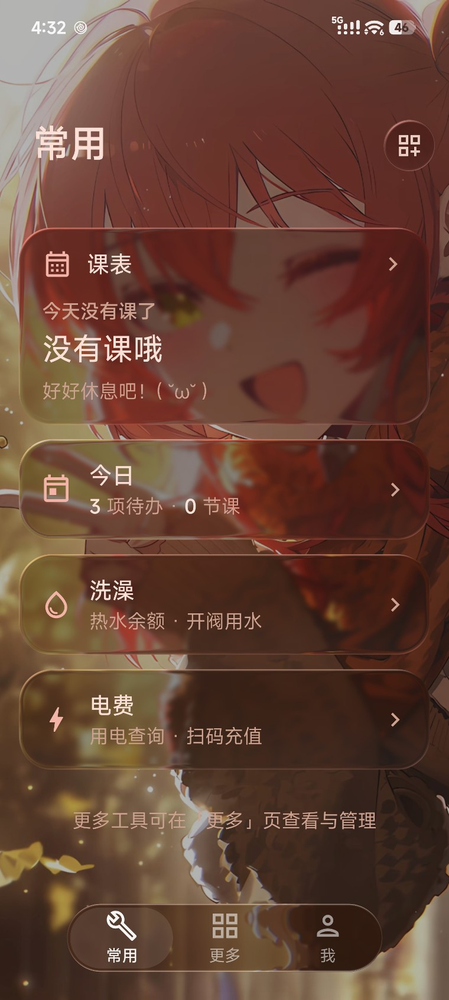
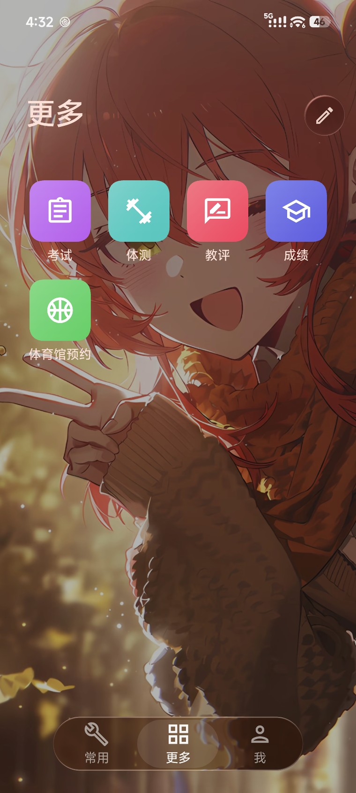
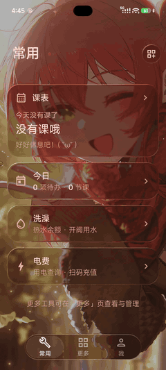
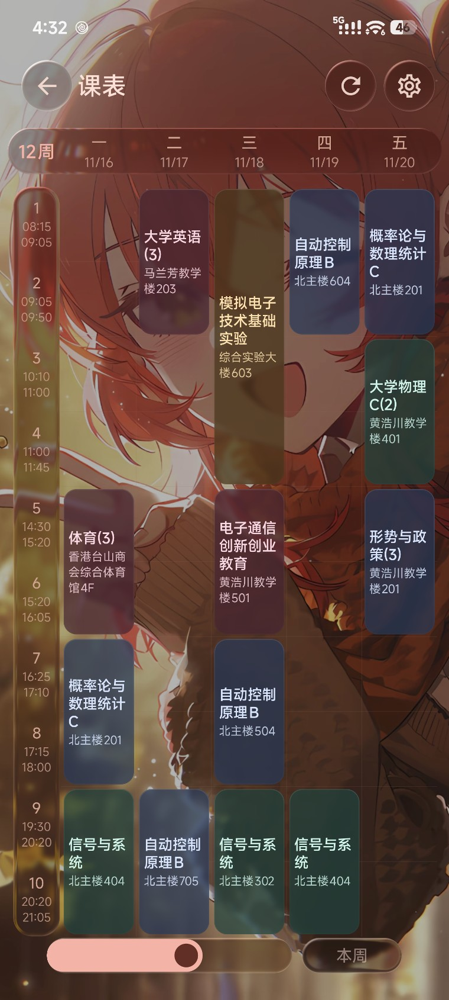
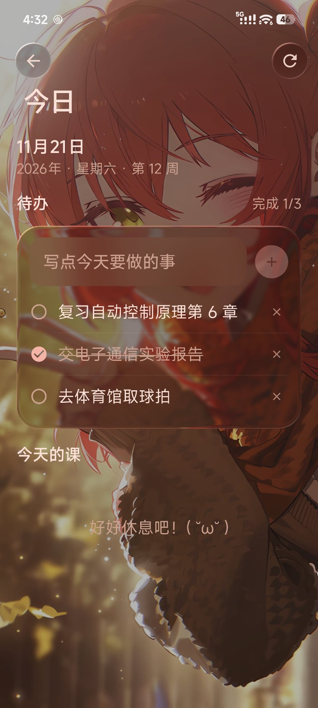
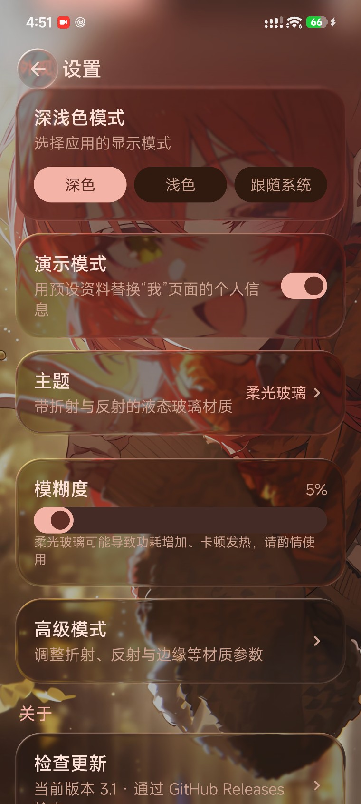
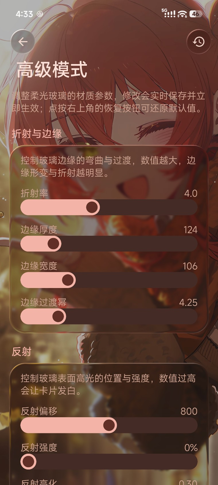

<p align="center"></p>

# WUKit

五邑大学校园服务的一站式 Android 工具。日常高频的校园功能原本散在几个小程序、公众号与网页里，WUKit 把它们收进一个约 2 MB 的应用：查课表、写待办、看热水与电费、约体育馆，都在同一套界面里完成。

使用 Kotlin + Jetpack Compose + Miuix 构建，界面参考 HyperOS 4：透明渐进顶栏、大标题折叠、悬浮胶囊底栏、卡片一镜到底转场，以及带折射与反射的液态玻璃材质。

## 主界面

<p align="center"></p>

底部悬浮胶囊里是三个页面，左右滑动或点按切换：

- **常用**：卡片式聚合。每张卡不只是入口，也带一句当下的状态——课表卡直接显示正在上或接下来的课，今日卡显示「n 项待办 · m 节课」，未导入课表时显示「课表未导入」而不是 0。
- **更多**：图标网格，装着没放进常用的工具；右上角铅笔进入编辑，可拖动排序。
- **我**：统一身份认证登录、教务系统入口、退出登录。
- **外观**：页面滚动时大标题收进顶栏，底栏是悬浮胶囊；壁纸可选预设渐变或相册图片，深浅色模式可跟随系统。

常用页的内容由用户自己决定。右上角的「显示卡片」把常用与更多放在同一张编辑页里：按住卡片右侧把手 150 ms 起拖，拖到下方就是收进「更多」，拖回上方就是放回常用；浮动卡片盖住下面那张的一半，下面的卡片就让位，相邻卡片用弹簧补位，更多工具标题同时上移给跨区拖动腾出位置。所有排布存在本机，重启后保持。

<p align="center"></p>

## 可打断动画引擎

卡片点开后不是换页，而是卡片自己长成页面：窗口的起点是卡片的真实位置与圆角，终点是全屏，卡片内容随窗口一起拉伸，并在窗口铺满时溶解为下一页的内容。壁纸、卡片与页面在同一帧里被捕获，所以缩放全程不会错位。

<p align="center"></p>

<p align="center">录屏：打开课表、返回、再打开今日，最后从「更多」里打开成绩。中途的任何一次点击或返回都会接管正在播放的动画。</p>

- **三层同时运动**：壁纸向前推、页面内容向后缩、背景压暗并模糊。三者共用一组全局时钟，任何一个窗口都只是「重定向」这组时钟，而不是自己从零播一遍。
- **任何一帧都能被打断**：打开到一半触发返回手势，进度就地反向，速度连续，不会先回到起点再重播。主动返回与被打断的返回走同一个弹簧、同一个出手速度，所以退出永远是同一种手感。
- **尾段不拦手**：窗口铺到 85% 之后页面就已经可以交互，弹簧还在收尾时也能立刻点返回，或直接点开另一张卡。
- **连点不跳帧**：快速点不同卡片时，旧窗口被新目标直接接管，共享时钟从屏幕上的当前值转向新目标，不会掉回默认缩放再重来。
- **同一条时间线**：顶栏折叠、页面横滑、拖拽补位同样由弹簧驱动，和转场共用一帧时钟，连续操作时不会有两条互不相干的动画在互相打架。

## 课表

<p align="center"></p>

登录统一身份认证后，应用会从教务系统导入本学期课表并缓存在本机，重新打开无需等待，离线也能查看。

- **周视图**：按节次时间轴展示整周课程，今天所在的列带底色；课程块按课程配色，多地点课程会按周显示对应教室。
- **切周**：拖动底部的玻璃滑条换周，右侧「本周」一键回到当前周；滑条本身也是液态玻璃，实时折射下面的课程。
- **课程详情**：点课程查看时间、地点、教师、周次与学期。
- **课表设置**：可显示或隐藏周六日；教务系统不返回当前周次，可在设置里校准本周周次，日期与今日课程都按此推算。

单日的安排交给「今日」页：日期、星期与周次，加上今天的课程与待办。

## 今日

<p align="center"></p>

今日页由两部分组成：待办与今天的课。

- **待办**：输入一行回车即添加，点圆圈勾选，右侧叉号删除，顶部显示「完成 x/y」。清单按天存储，跨天自动清空，不需要登录也能用。
- **今天的课**：按时间列出当天的全部课程，上完的也保留，方便回看；正在上的标出「正在上课」。没有课表数据时给出登录入口，而不是空白。

## 校园网

从「更多 → 校园网」进入。页面先判断当前网络：没有 WLAN/以太网、已在校园网中、还是需要门户认证，状态卡只给出一种明确结论，不重复提示。

- **账号管理**：右上角玻璃按钮进入二级页，一个账号一张玻璃卡；卡片左端常驻圆形选择按钮，单选切换当前账号。保存账号即记住密码，可编辑或删除。
- **连接**：门户配置块里取真正的 ticket / auth / keep / term 地址，随请求带上门户下发的 Algo-ID 与校验头完成广东校园认证。连接后状态卡以大字号显示 `HH:MM:SS`，未连接与已连接之间用叠加模糊渐变切换。
- **登录态**：票据、设备标识与学校标识保存在本机。重新打开应用后，只有在确认网络已通时才用原票据打一次心跳验真，通过后才恢复在线并接续计时；主动断开会清掉本地票据，不会留下假在线状态。
- **日志**：右上角设置按钮里可手动开启校园网日志，默认关闭。

密码层编译自开源项目 [ESurfingClient-CVersion](https://github.com/BadGhost520/ESurfingClient-CVersion)（Apache-2.0），源码来源与重建方式见 `app/src/main/cpp/esurf/README.md`。

## 液态玻璃

<p align="center">


</p>

卡片、顶栏按钮、悬浮底栏与课表滑条使用同一种材质：实时采样自身下方的画面，做模糊、折射与边缘高光，再叠一层很薄的底色。它不是一张预先烘焙的模糊图，所以滚动、切周、拖动时玻璃里的内容会跟着动。

- **折射与边缘**：折射率、边缘厚度、边缘宽度与过渡幂共同决定窗口边缘的弯曲程度；数值调大，边缘形变与折射更明显，调小则更接近普通磨砂。
- **反射**：反射偏移决定高光位置，反射强度决定高光强弱，过高会让卡片发白；「反射亮化」单独控制高光提亮的幅度。
- **底色与饱和度**：卡片底色在浅色与深色下分别设置，深色默认不叠底色；背景饱和度也分深浅两档。
- **设置入口**：`设置 → 主题` 在默认（磨砂）、液态玻璃、柔光玻璃三种材质间切换；液态玻璃下方是独立的「模糊度」卡片，只调一个模糊半径；「高级模式」把上面这些材质参数摊开，改动即时生效，右上角可一键恢复默认。

液态玻璃需要 Android 13（API 33）及以上。它会持续对画面做实时采样与模糊，可能增加功耗与发热，请酌情使用。

推荐搭配深色模式：浅色界面里卡片几乎压在白色背景上，折射与边缘高光容易被底色吃掉；深色模式下壁纸的颜色更沉，玻璃的层次、边缘的亮边和底下的内容都更清楚（上面的截图即深色模式）。模糊度可调：个位数时玻璃接近透明，壁纸几乎原样透出来，想更柔和就往 15% 左右调，再高就糊成一片色块。

## 其他功能

- **洗澡**：热水与冷水余额、更换宿舍设备、一键开启热水阀，开阀后开始计费。
- **电费**：查剩余电量、折合电费、近期日均与预计可用天数，查看充值记录与用电趋势，按金额生成学校电费系统的支付二维码。
- **体育馆预约**：按日期、项目与场馆筛选时段并预约；「我的预约」按学期统计时长，并把时长折算成抵消的校园跑公里数。
- **考试 / 成绩 / 教评 / 体测**：教务系统的查询入口，成绩可看单科分析，体测看总分与各项。
- **设置**：预设与相册壁纸、背景亮度、深浅色模式、演示模式、检查更新。

## 下载

前往本仓库的 **Releases** 页面下载最新的 APK。

- 系统要求：Android 8.0（API 26）及以上；液态玻璃、柔光玻璃需要 Android 13 及以上
- 安装包约 2 MB

## 构建

需要 JDK 17 与 Android SDK（compileSdk 37）。

```bash
./gradlew :app:assembleRelease
```

产物位于 `app/build/outputs/apk/release/app-release.apk`。
`app/libs/` 下为构建所需的外部库（二维码库、SharedViewKit），请勿删除。

## 说明

- 本项目为非官方工具，仅供学习交流，与学校及任何官方平台无关，请遵守学校相关规定。
- 登录凭据仅保存在本机，并通过 Android Keystore 加密；请勿在不可信设备上登录。
- 开阀、充值等操作会产生实际费用，请谨慎确认后再执行。
- 部分功能依赖校园网络环境，具体可用性以学校平台为准。
- 截图使用演示模式与示例数据，个人信息已作替换。

## 开源协议

本项目代码基于 [MIT License](LICENSE) 开源。第三方依赖与 `app/libs/` 下的预编译库遵循其各自的许可协议，不在 MIT 许可范围内。

## 使用的开源项目

WUKit 的实现使用或参考了以下 GitHub 开源项目，版权与许可归各自作者所有：

- [AndroidX / Jetpack Compose](https://github.com/androidx/androidx) — 界面、生命周期与导航（Apache-2.0）
- [Miuix](https://github.com/compose-miuix-ui/miuix) — Compose 组件库与视觉语言（Apache-2.0）
- [OkHttp](https://github.com/square/okhttp) — 网络请求（Apache-2.0）
- [MaterialKolor](https://github.com/jordond/materialkolor) — Material You 动态取色（MIT；上游 Material Color Utilities 为 Apache-2.0）
- [ZXing](https://github.com/zxing/zxing) — 电费支付二维码（Apache-2.0）
- [ESurfingClient-CVersion](https://github.com/BadGhost520/ESurfingClient-CVersion) — 校园网门户密码算法与协议参考（Apache-2.0）

`app/libs/` 下的 SharedViewKit 为 Gitee 分发的闭源 SDK，不属于上述 GitHub 开源项目。
