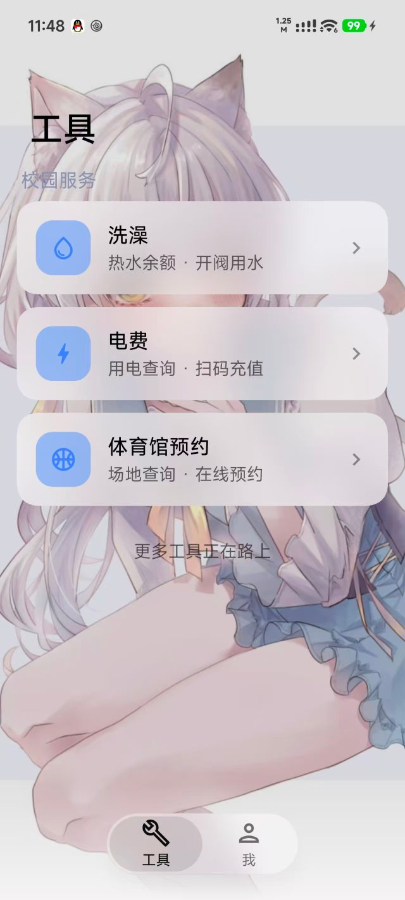
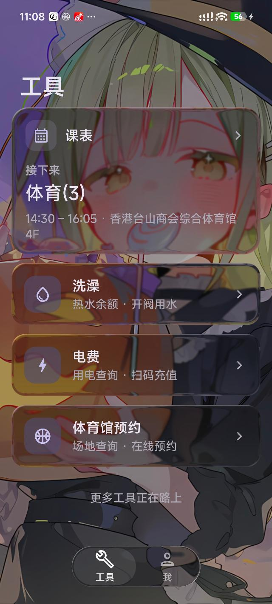
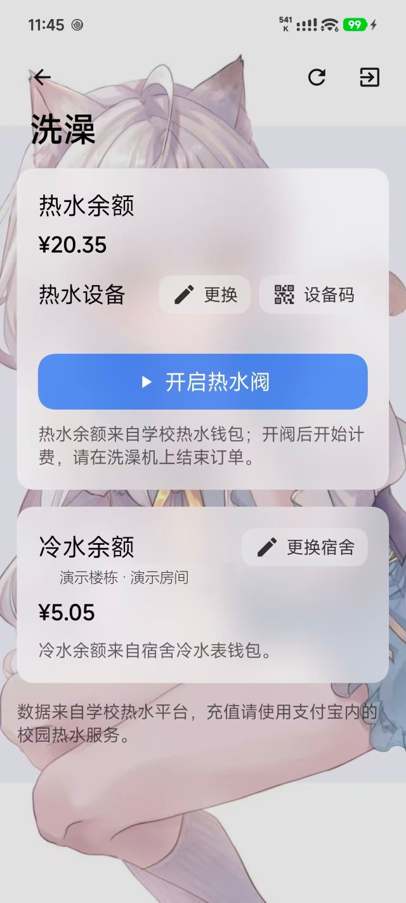
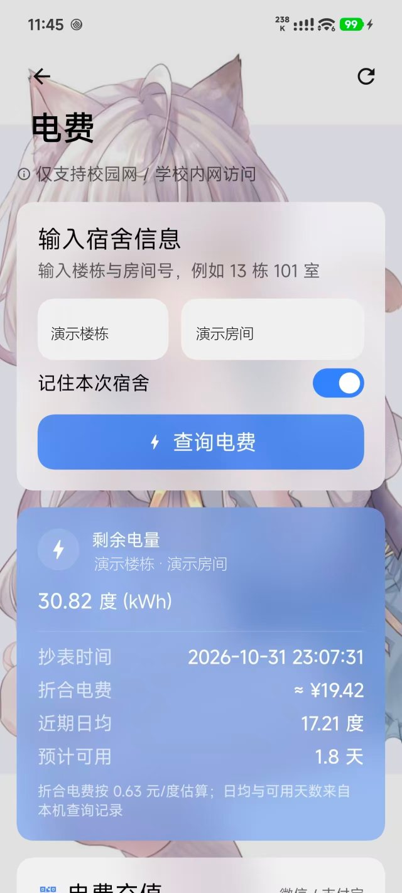
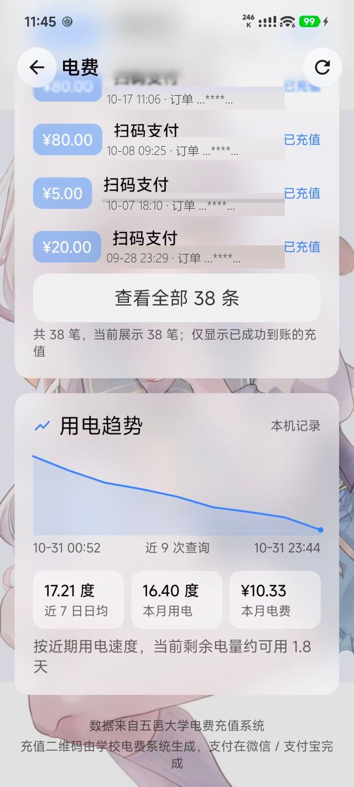
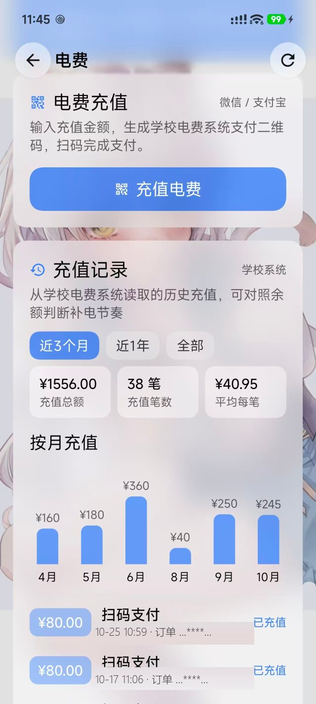
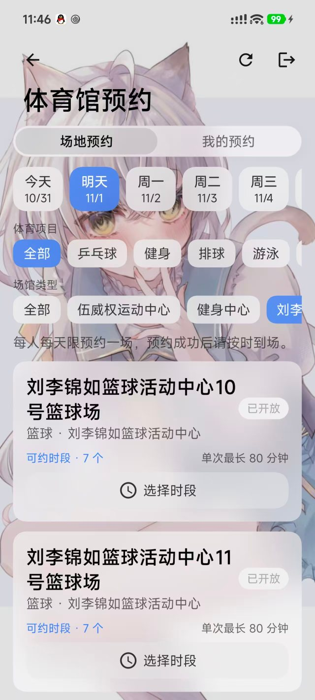
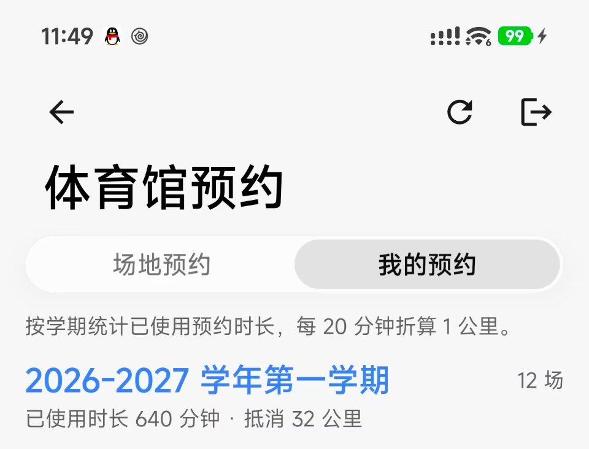
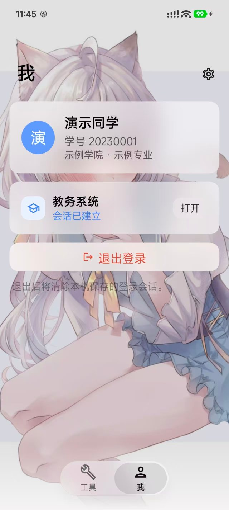
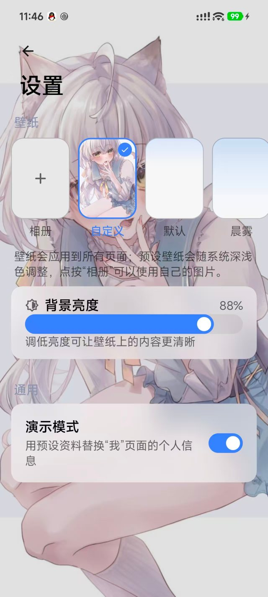

# WYUtools

## 简介

重磅推出“WYUtools”！

旨在解决日常校园生活高频功能需要各种💩小程序，APP，网页来回使用的不便，体积小巧不超过50Mb。

五邑大学校园服务的一站式 Android 工具，把日常高频的校园功能收进一个轻量应用。
使用 Kotlin + Jetpack Compose + Miuix 构建，
界面参考 HyperOS 4：透明渐进顶栏、大标题折叠、悬浮底栏、卡片一镜到底转场与柔光玻璃卡片。

## 功能

- **课表**：登录后自动导入教务系统课表，提供「壹日」与「邑周」两种视图，支持周次切换、当前课程高亮与周末显示设置。
- **洗澡**：热水余额、设备绑定与开阀，支持用水时长统计。
- **电费**：余额查询、用电趋势、充值记录。
- **体育馆**：场地与时段查询、在线预约，按学期统计预约时长与抵消校园跑公里数。
- **我**：统一认证登录、个人信息、教务系统入口（支持演示模式）。
- **设置**：预设壁纸与相册自定义壁纸、背景明暗调节、演示模式。

## 界面展示

> 截图中的楼栋、房间与订单号等信息已作遮挡处理。

### 工具主页

<p align="center"></p>

首页以卡片聚合校园服务，当前提供课表、洗澡、电费与体育馆预约；课表卡片会直接显示正在上或接下来的课程。卡片支持一镜到底转场，配合透明渐进顶栏、悬浮底栏与自定义壁纸。

### 柔光玻璃（Beta）

<p align="center"></p>

柔光玻璃材质参考 HyperOS 4 与 HyperLight 1.2.3 的实现：卡片与顶部按钮会实时折射、模糊其下方的壁纸，边缘带有折射与高光；悬浮底栏为液态玻璃样式，模糊半径跟随柔光玻璃设置联动。截图中模糊半径手动调为 10%，以保留更多壁纸细节。

可在「设置 → 柔光玻璃」开启并调节模糊半径。该功能需要 Android 13（API 33）及以上，属于实验性功能，开启后可能增加功耗与发热，请酌情使用。

### 课表

登录统一身份认证后，应用会从教务系统导入本学期课表并缓存在本机，重新打开无需等待加载，离线也能查看。

- **壹日**：按日期展示当天课程，自动略过已结束的课；正在上的课高亮显示，并提前展示“接下来”的课程。
- **邑周**：按节次时间轴展示整周课程，今天所在列带底色；拖动顶部滑杆切换周次，可一键“回到本周”，多地点课程会按周显示对应教室。
- **课程详情**：点击课程可查看时间、地点、教师、周次与学期信息。
- **课表设置**：可显示或隐藏周六日；教务系统不返回当前周次，可在设置中校准本周周次，日期与“壹日”课程会按此推算。

### 洗澡

<p align="center"></p>

查看热水、冷水余额，更换热水设备，一键开启热水阀；开阀后开始计费。

### 电费

<table>
<tr>
<td align="center"><br>查询余额</td>
<td align="center"><br>充值记录与用电趋势</td>
<td align="center"><br>充值与按月统计</td>
</tr>
</table>

- **查询**：输入楼栋与房间号后可记住宿舍，展示剩余电量、折合电费、近期日均与预计可用天数。
- **记录**：按笔查看充值记录，支持查看全部记录，并提供用电趋势与本月用电、电费统计。
- **充值**：输入金额通过学校电费系统生成支付二维码，走官方渠道，支持微信/支付宝扫码支付，并按月汇总充值金额。

### 体育馆预约

<table>
<tr>
<td align="center"><br>场地预约</td>
<td align="center"><br>我的预约 · 学期时长与校园跑抵消计算</td>
</tr>
</table>

- **场地预约**：按日期、体育项目与场馆筛选，查看可约时段与单次最长预约时长，直接选择时段预约。
- **我的预约**：按学期统计已使用预约时长与场次；每 80 分钟折算 4 公里，可直接查看本学期抵消的校园跑公里数（图中为 640 分钟，抵消 32 公里）。

### 我

<p align="center"></p>

统一认证登录后展示个人信息，可直接打开教务系统；退出登录会清除本机保存的会话。开启演示模式后，个人信息会替换为预设资料。

### 设置

<p align="center"></p>

支持相册自定义壁纸与预设壁纸，可调节背景亮度，并提供柔光玻璃开关与模糊半径调节；演示模式开关位于此处。

## 下载

前往本仓库的 **Releases** 页面下载最新的apk文件

- 系统要求：Android 8.0（API 26）及以上
- 安装包约 1.8 MB

## 构建

需要 JDK 17 与 Android SDK（compileSdk 37）。

```bash
./gradlew :app:assembleRelease
```

产物位于 `app/build/outputs/apk/release/app-release.apk`。
`app/libs/` 下为构建所需的外部库（二维码库、SharedViewKit），请勿删除。

## 说明

- 本项目为非官方工具，仅供学习交流，与学校及任何官方平台无关，请遵守学校相关规定。
- 登录凭据仅保存在本机，并通过 Android Keystore 加密；请勿在不可信设备上登录。
- 开阀、充值等操作会产生实际费用，请谨慎确认后再执行。
- 部分功能依赖校园网络环境，具体可用性以学校平台为准。

## 开源协议

本项目代码基于 [MIT License](LICENSE) 开源。第三方依赖与 `app/libs/` 下的预编译库遵循其各自的许可协议，不在 MIT 许可范围内。

